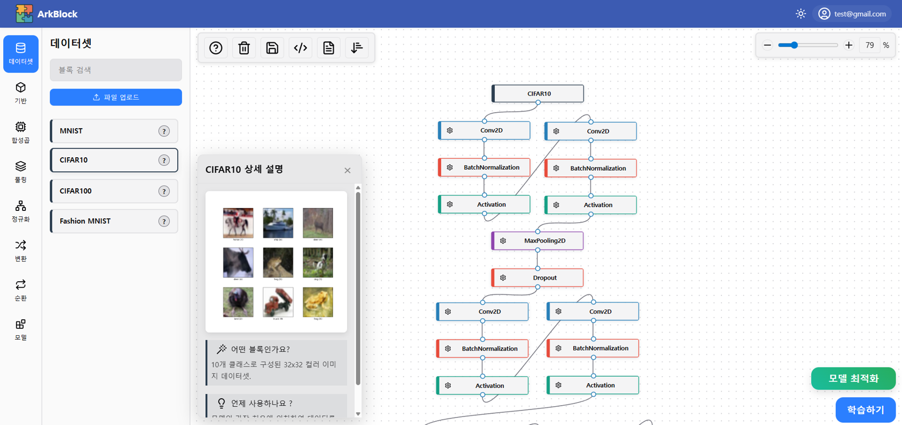
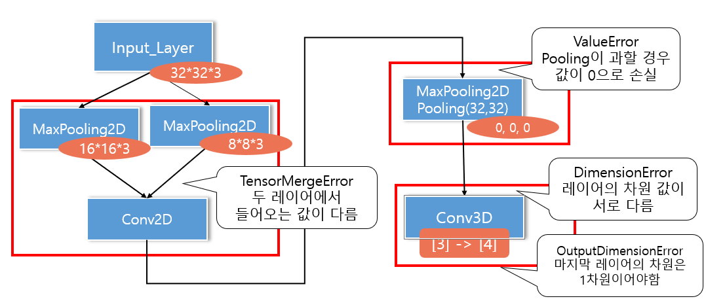
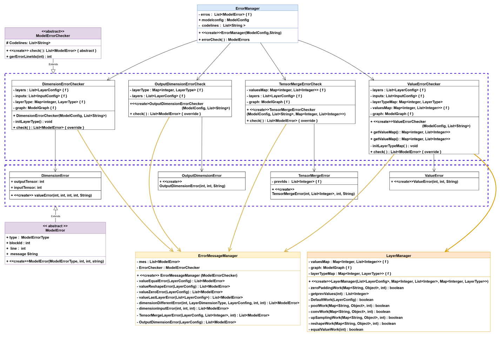
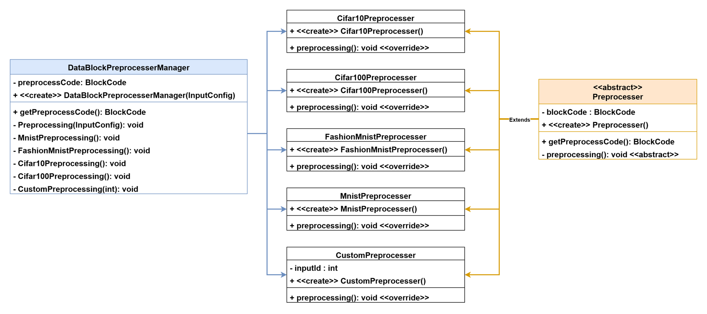

# 🧩 ArkBlock

**블록 코딩을 활용한 딥러닝 모델 레이어 교육 솔루션**

딥러닝 층의 역할과 층의 구조를 만드는 법에 대한 학습을 돕는 솔루션

---

## 📌 프로젝트 개요

| 구분 | 내용 |
| --- | --- |
| 개발 기간 | 2025.06 ~ 2025.08 |
| 팀 구성 | `5인` |
| 내 역할 | BlockIntellisense(레이어 연결 검증) · BlockPreprocessor(데이터셋 전처리) 설계·구현 |
| 저장소 | [github.com/ArkBlock/web_server](https://github.com/ArkBlock/web_server) |

### 🎯 목적
AI에 대한 지식은 있으나 코딩 경험이 부족한 경우, 또는 딥러닝을 학습하는 과정에 있는 경우를 돕기 위해, 직관적인 툴과 교육 목적의 시각화 기능을 구현했습니다.

### 💭 기획 배경
"손쉬운 AI 개발 서비스 플랫폼 BlockAI"(현재 서비스 종료)에서 아이디어를 착안하여 기획·개발했습니다.

---

## 🧰 기술 스택

| 구분 | 기술 | 사용 목적 |
| --- | --- | --- |
| Language | Java | 팀의 서버 개발 환경에서 사용, 웹 서비스 백엔드 구현 |
| Language | Python | AI 모델 학습 및 데이터 처리 |
| AI Framework | Keras | 딥러닝 모델 구성 및 학습 |
| Frontend | Svelte | 웹 클라이언트 UI 및 기능 구현 |
| AI / Optimization | Optuna | AI 모델 하이퍼파라미터 최적화 |

---

## 🖥 솔루션 메인 화면

사용자가 별도의 Python 코드 작성 없이 레이어 블록을 조합해 AI 모델을 구성하고, 모델 설계부터 학습용 데이터 전처리까지 수행할 수 있는 솔루션입니다.

### 솔루션 주요 기능 (팀 단위)

1. 블록 기반 AI 모델 구성 – 각 레이어를 블록으로 제공해 코딩 없이 모델 구성
2. Python 코드 자동 생성 – 캔버스에서 레이어를 연결하면 구조에 맞는 Python 코드가 실시간 생성
3. 실시간 모델 구조 검증 – 입력·출력 차원과 파라미터 유효성을 검증하고, 잘못된 연결은 인텔리센스로 오류 안내
4. 모델 파라미터 최적화 – 구성된 레이어·파라미터를 기반으로 학습 조건 조정
5. 데이터셋 자동 전처리 – 모델 입력 형태에 맞게 데이터셋 전처리

---

## 🛠 담당 업무

AI 모델의 기본 구조와 레이어 간 연산 관계를 학습하고, 이를 서비스 기능으로 구현했습니다.

- 레이어 연결 관계를 검증하는 BlockIntellisense 설계·구현
- 데이터셋 전처리 파이프라인 BlockPreprocessor 구축
- CNN의 Convolution  · Pooling 등 레이어 연산 구현
- Python 코드를 입력하면 해당 코드에 맞는 레이어 블록을 생성하는 기능 구현

---

## 💡 핵심 구현

### 1. BlockIntellisense – 레이어 연결 실시간 검증

사용자가 캔버스에서 블록을 잘못 연결했을 때 오류의 원인을 실시간으로 파악할 수 있도록, 레이어 간 연결 관계를 검증하는 인텔리센스 로직을 설계하고 구현했습니다.

| 오류 | 검증 내용 |
| --- | --- |
| **DimensionError** | 현재 레이어의 출력 차원과 다음 레이어의 입력 차원이 일치하는지 검증 |
| **ValueError** | 레이어 간 연산에 필요한 값이 유효한지 검증. Pooling이 반복돼 데이터 값이 소실(0)되는 경우를 탐지 |
| **TensorMergeError** | 여러 입력을 병합할 때 각 Tensor의 크기가 같은지 검증 (예: `3×3`+`3×3`은 정상, 크기가 다르면 오류) |
| **OutputDimensionError** | 최종 출력 레이어의 차원이 요구되는 형태인지 검증 |

#### 클래스 설계

- 추상 클래스 `ModelErrorChecker`를 상속한 오류 유형별 Checker(`DimensionErrorChecker`, `OutputDimensionErrorCheck`, `TensorMergeErrorCheck`, `ValueErrorChecker`)가 각자 `check()`를 구현합니다.
- `ErrorManager`가 Checker들을 모아 `errorCheck()`로 모델 전체의 오류를 수집합니다.
- 오류는 추상 클래스 `ModelError`(유형·블록 ID·라인·메시지)를 상속한 오류별 클래스로 표현하고, `ErrorMessageManager`가 사용자에게 보여줄 메시지를 생성합니다.
- `LayerManager`가 패딩·풀링·합성곱·업샘플링·reshape 등 레이어별 출력 값 계산을 담당해 Checker가 공통으로 사용합니다.
- 새 오류 유형이 필요하면 Checker와 Error 클래스를 추가하는 방식으로 확장할 수 있는 구조입니다.

### 2. BlockPreprocessor – 데이터셋 전처리 파이프라인

AI 모델 학습에 쓰이는 데이터셋을 자동으로 전처리하는 파이프라인을 구축했습니다.

- CIFAR-10 · CIFAR-100 · MNIST · Fashion-MNIST 등 기본 제공 데이터셋 전처리 지원
- 사용자가 직접 데이터를 입력하는 Custom 데이터셋 전처리 지원
- 모델 학습에 필요한 형태로 데이터를 변환해 이후 학습 단계에서 활용
- 추상 클래스 `Preprocesser`를 상속한 데이터셋별 전처리 클래스를 `DataBlockPreprocesserManager`가 입력 설정에 따라 호출하는 구조

---

## 🔥 어려웠던 점 / 해결 방법

- **문제**: 머신러닝 사전 지식이 부족한 상태에서, 약 2주 안에 필요한 개념을 학습하고 프로젝트에 적용해야 했음. 특히 CNN의 Convolution · Pooling 연산을 직접 구현하는 과정이 어려웠음
- **해결**: 팀원의 도움으로 기본 개념을 빠르게 익힌 뒤, 구현을 통해 이해도를 높였음. 막히는 부분은 포기하지 않고 매달렸고, 하루를 투자해도 풀리지 않는 문제는 팀원과 함께 해결
- **결과**: 짧은 기간에 모르는 영역을 구현하며 학습하는 방식을 익힘

---

## 🌱 결과 및 배운 점

- CNN의 Convolution · Pooling 등 레이어를 직접 구현했고, Python 코드를 입력하면 해당 코드에 맞는 레이어 블록을 생성하는 기능까지 구현했습니다.
- 백지에서 코드를 직접 구현하는 데 느낀 한계를 완전히 넘지는 못했지만,팀워크의 중요성을 깨달았습니다.
- 서비스 종료된 유사 서비스에서 아이디어를 얻어, 교육 목적의 오류 인텔리센스 기능을 직접 설계해 본 경험이 되었습니다.

---
