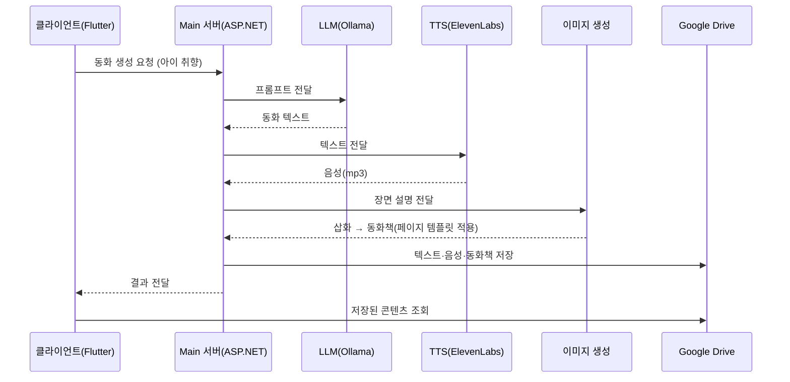

# 🧚 Custom Fairytale

**아이의 취향을 동화로 만드는 AI 맞춤형 동화·오디오 생성 서비스**

---

## 📌 프로젝트 개요

| 구분 | 내용 |
| --- | --- |
| 개발 기간 | 16주 |
| 팀 구성 | `4인` |
| 내 역할 | **기획 · 서비스 설계 · 백엔드(메인 서버) 개발** · 클라이언트 개발 지연 시 직접 지원 |
| 저장소 | `[GitHub 링크 입력]` |

### 🎯 목적
맞벌이 부부가 늘면서, 아이에게 잠들기 전 책을 읽어줄 여력이 부족한 상황이 늘고 있습니다. 부모가 직접 읽어주기 어려울 때 사용할 수 있는 서비스를 만드는 것이 목표입니다. 아이의 취향을 입력하면 AI가 동화 텍스트 · 삽화 · 음성(오디오)을 만들어 한 권의 동화책으로 제공합니다.

---

## 🧰 기술 스택 및 선택 이유

| 영역 | 기술 | 선택 이유 |
| --- | --- | --- |
| Backend | C# · ASP.NET Core | 익숙한 언어를 서버 개발에 적용해 학습 비용을 줄이고 구현에 집중 |
| Frontend | Flutter | 모바일 접근성이 좋고, 초보자도 Figma 시안을 기반으로 쉽게 화면 구현 가능 |
| DB | SQLite (EF Core) | 모바일 환경에서 가장 가벼운 DB, 로그·세션 관리용 |
| AI – LLM | Ollama (EEVE-Korean-10.8B) | 한국어 동화 텍스트 생성 |
| AI – TTS | ElevenLabs API | 동화 음성(mp3) 생성 |
| AI – Image | DALL·E API | 동화 삽화 생성 |
| Storage | Google Drive API | 스토리·음성·동화책 파일 저장 및 클라이언트 전달 |

---

## 🏗 아키텍처

### 레이어 구조

| 레이어 | 구성 | 역할 |
| --- | --- | --- |
| 클라이언트 | Flutter 모바일 앱 | 부모 중심 인터페이스에서 동화 생성 요청·조회 |
| 서버 | RESTful API Gateway → Controller → Service → Entity Framework(SQLite) | 요청 수신, 비즈니스 로직, AI·저장소 연동 |
| AI 외부 서비스 | Ollama LLM · 이미지 생성 · ElevenLabs TTS · Google Drive API | 동화 텍스트·삽화·음성 생성, 파일 저장 |
| 데이터 | Google Drive(스토리·음성·동화책) · SQLite(로그/세션) | 생성물과 사용자 정보 분리 저장 |

### 데이터 흐름

---

## 🛠 담당 업무

### 설계
- 솔루션 컨셉을 구체화하기 위해 **서비스 UI 디자인 베이스**와 주요 화면·기능 흐름을 설계
- **백엔드 시스템 구조와 데이터 흐름**을 설계하고, 클라이언트–서버 간 통신 구조를 구성

### 구현
- C# / ASP.NET으로 **메인 서버 설계·구현**
- LLM · TTS · 이미지 생성 등 **핵심 AI API 연동**, API 호출 및 데이터 처리 파이프라인 구현
- 클라이언트 요청에 따라 필요한 AI API를 호출하고 **처리 결과를 클라이언트에 전달**하는 서버 로직 구현

---

## 💡 핵심 구현

### 1. 멀티 AI API 기반 파이프라인
메인 서버를 중심으로 **LLM → TTS → 이미지 생성**이 이어지는 처리 파이프라인을 구성했습니다. 각 AI API의 요청·응답 형식이 서로 다르기 때문에 서버에서 이를 가공하고, 클라이언트는 **항상 일관된 방식으로 결과를 받도록** 했습니다. 외부 API의 차이를 서버가 흡수하므로 AI 모델을 교체해도 클라이언트 변경을 최소화할 수 있는 구조입니다.

### 2. 동화책 페이지 템플릿 포맷 구조
생성된 글과 삽화가 **정해진 위치에 배치**되도록 여러 페이지 템플릿을 구성했습니다. 콘텐츠의 **유형과 분량에 따라 적절한 템플릿을 선택**하고, 텍스트와 이미지를 지정된 영역에 채워 동화책 페이지를 만듭니다.

### 3. 계층형 서버 구조
`API Gateway → Controller → Service → Entity Framework` 구조로 책임을 나눴습니다. AI 호출과 파일 저장은 Service 계층에서 담당해 Controller는 요청·응답 처리에만 집중하도록 했습니다.

---

## 🔥 문제 해결 / 어려웠던 점

### ① 처음 해보는 서버 구조 설계와 구현
- **문제**: 레이어·프로젝트 구조를 설계하고 서버를 직접 구현하는 것이 처음이라, 초기에 전체 구조를 잡기 어려웠음
- **해결**: ASP.NET 공식 문서를 기반으로 필요한 기능을 하나씩 학습·구현하고, AI로 코드 동작 원리를 확인·이해한 뒤 직접 적용하는 과정을 반복
- **결과**: 기술을 단순히 사용하는 데서 그치지 않고, 필요한 개념을 스스로 학습해 구현하는 경험을 쌓음

### ② 팀원 이탈 상황에서의 역할 분배
- **문제**: 팀원들이 비전공 진로 준비·인턴십으로 지속적으로 참여하기 어려워, 기획부터 개발까지 대부분을 맡아야 했음
- **해결**: 모든 업무를 혼자 처리하는 대신 팀원이 할 수 있는 일을 **구체적으로 쪼개 요청** (AI API 모델 비교·테스트, UI/UX 디자인 등). 클라이언트 개발이 지연되면 직접 지원
- **결과**: 전체 개발 일정이 밀리지 않도록 조율

---

## 🌱 결과 및 배운 점

- 팀원들과 역할을 조율하며 프로젝트를 끝까지 완성했습니다. (최종 평가: `A0`)
- 새로운 기술을 공식 문서와 다양한 자료로 스스로 학습해 실제 기능으로 구현하는 방법을 익혔습니다.
- 팀원의 상황에 맞춰 역할을 분배하고, 진행 상황에 따라 필요한 업무를 직접 지원하며 팀을 이끄는 경험을 했습니다.

---
