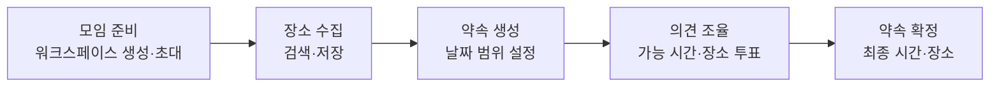
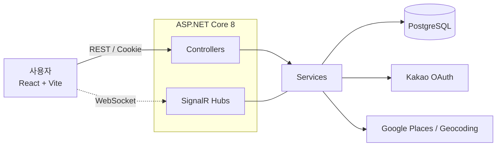
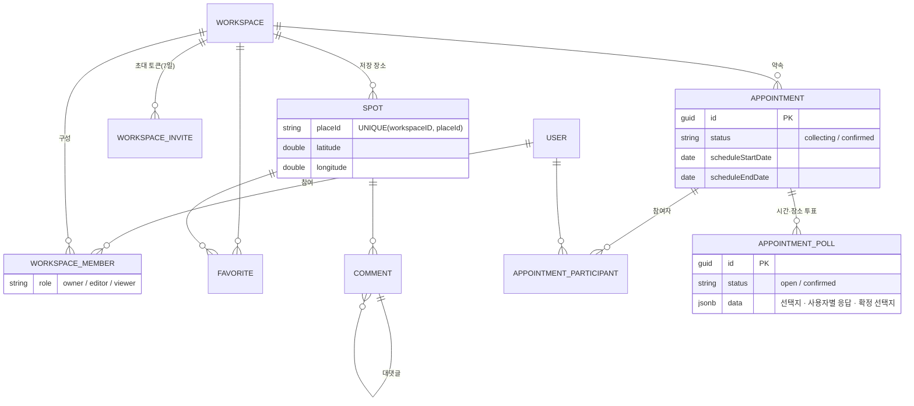

## 📌 Project. 동네방네 (Every Corner)

> 친구·동아리·스터디 구성원이 **“언제, 어디서 만날지”** 를 한 곳에서 정하는 약속 조율 웹 서비스

---

| 구분 | 내용 |
| --- | --- |
| 프로그램 | 미래내일 일경험 프로젝트형 · 참여기업 ㈜코아아이티 |
| 기간 | 8주 |
| 팀 구성 | 4인 |
| 내 역할 | 백엔드 |
| 기술 스택 | ASP.NET Core · PostgreSQL · Docker Compose · Kakao OAuth · Google Places API |

### 해결하려던 문제

1. **일정 조율의 번거로움** – 대화방에 흩어진 가능 시간을 사람이 직접 다시 읽고 취합해야 함
2. **장소 의견 취합의 어려움** – 서로 다른 장소 제안을 구분하고 선호를 비교하기 어려움
3. **플랫폼 파편화** – 지도앱 저장 → 메신저 공유 → 개별 확인의 반복

### 서비스 흐름

---

## 🛠 담당 업무

- ASP.NET Core 기반 REST API 설계·구현(인증·워크스페이스·장소·즐겨찾기·댓글·약속·투표)
- 카카오 OAuth + 쿠키 인증
- SignalR 기반 실시간 댓글 알림
- Docker Compose 실행·마이그레이션 환경, 통합 테스트, 기능별 API 문서 작성

---

## 🏗 아키텍처

### 시스템 구성

### ERD

---

## 💡 핵심 구현

### 1. 시간·장소 조율을 한 번에,
날짜 범위가 있는 약속을 만들면 같은 트랜잭션에서 시간 투표와 장소 투표를 함께 생성합니다.

### 2. 행 잠금으로 동시성 제어
후보 추가·투표·확정 같은 약속 변경 작업을 `SELECT … FOR UPDATE` 행 잠금과 트랜잭션으로 직렬화했습니다. 여러 참여자가 동시에 같은 장소를 후보로 추가하거나, 확정과 투표가 겹쳐도 데이터가 어긋나지 않습니다.

### 3. JSONB로 유연한 투표 모델
투표의 선택지·사용자별 응답·확정 선택지를 PostgreSQL `jsonb` 한 컬럼(`PollData`)에 저장했습니다. 시간 투표와 장소 투표를 같은 구조로 다루면서 복수 선택·변경·취소를 지원하고, EF Core `ValueConverter` / `ValueComparer`로 변경 감지를 정확히 처리했습니다.

### 5. 제약조건으로 데이터 무결성 보장
- `(workspaceID, placeId)` 유니크 인덱스로 같은 장소의 중복 저장 방지.
- `(workspaceID, userID)` 유니크로 중복 멤버 방지, 약속 참여자는 복합 키
- 초대는 7일 만료 토큰, 멤버 추방 시 기존 초대 링크 모두 폐기
- 워크스페이스 삭제는 이름 재입력 확인 후 FK 연쇄 삭제를 한 트랜잭션으로 처리

---

## 🔌 주요 API

| 영역 | 엔드포인트 | 설명 |
| --- | --- | --- |
| 인증 | `POST /api/auth/kakao/login` · `GET /api/auth/me` · `POST /api/auth/onboarding` | 카카오 로그인, 쿠키 발급, 프로필 온보딩 |
| 워크스페이스 | `POST·GET·PATCH·DELETE /api/workspace` | 생성·목록·수정·삭제(소유자) |
| 초대 | `POST /api/workspace/{id}/invite` · `POST /api/invite/{token}/join` | 7일 만료 초대 링크 |
| 장소 | `GET·POST /api/workspace/{id}/spots` · `/spots/import` | 워크스페이스별 장소 저장 |
| 약속 | `POST /api/workspace/{id}/appointments` · `GET /api/appointments/{id}` | 약속 생성·상세 |
| 투표 | `POST /api/appointments/{id}/polls/{pollId}/votes` · `/candidates` | 투표 제출·장소 후보 추가 |
| 확정 | `POST /api/appointments/{id}/confirm` | 최종 시간·장소 동시 확정 |
| 실시간 | `/hubs/comment` (SignalR) | 댓글 알림 |

> 상세 요청·응답은 `docs/` 의 기능별 문서(약속·투표, 조율, 장소, 설정, 온보딩, 삭제)와 Swagger에 정리했습니다.

---

## 🔥 회고

### GCP VM 배포 시도
로컬에서는 Docker Compose로 정상 동작했지만, GCP VM에 배포하는 과정에서 서비스를 정상 구동하지 못했습니다. 이후, `docker-compose.yml`의 환경변수가 항상 우선 적용되어 CORS가 막혔다는 사실을 배우고 정리했습니다.

**배운 점**
- “내 로컬에서 되는 것”과 “배포 가능한 것”은 다르며, **배포 계획을 개발 초기에 세워야** 한다
- 설정 값이 **어디에서 최종 결정되는지**(기본 설정 < 환경변수) 알아야 디버깅 시간이 줄어든다
- 진행 상황·결정 기록을 팀 전체가 공유하지 못해 시행착오가 길어졌고, 이후 **배포 계획·기록 관리 체계화**의 필요성을 팀 회고에 반영했다

---

## 🌱 성과 & 배운 점

- 8주 안에 모임 생성·초대 → 장소 저장 → 약속 생성 → 시간·장소 투표 → 약속 확정까지 하나의 흐름을 백엔드로 완성
- 멘토링에서 지도 서비스 예외 상황을 원인 분석 후 재구현하고, 장소 투표 UX에 대한 팀 의견을 조율해 기존 결정을 유연하게 수정하는 협업 역량을 평가받음
- 최종 점검에서 솔루션의 문제 해결 가능성과 활용 방향에 긍정적 피드백
- 요청·응답 구조와 기능 경계를 사전에 합의하고 프론트엔드와 API 계약을 계속 조정하는 것이 안정적인 통합의 핵심임을 체감
---